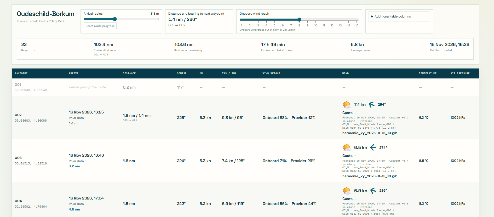
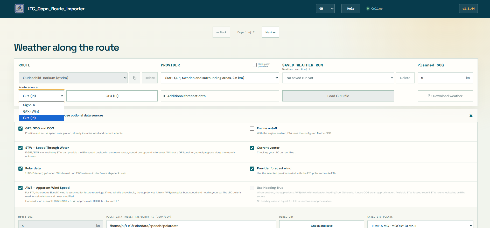
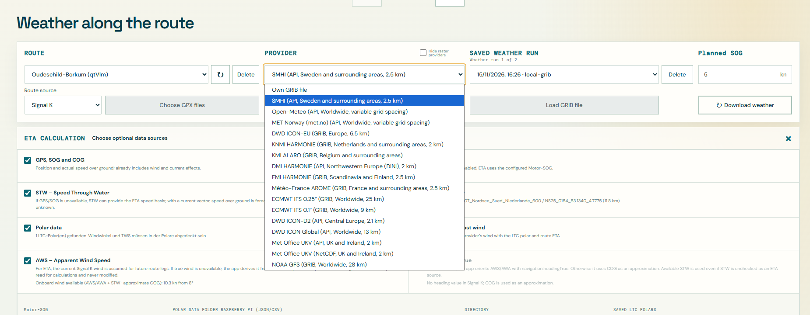
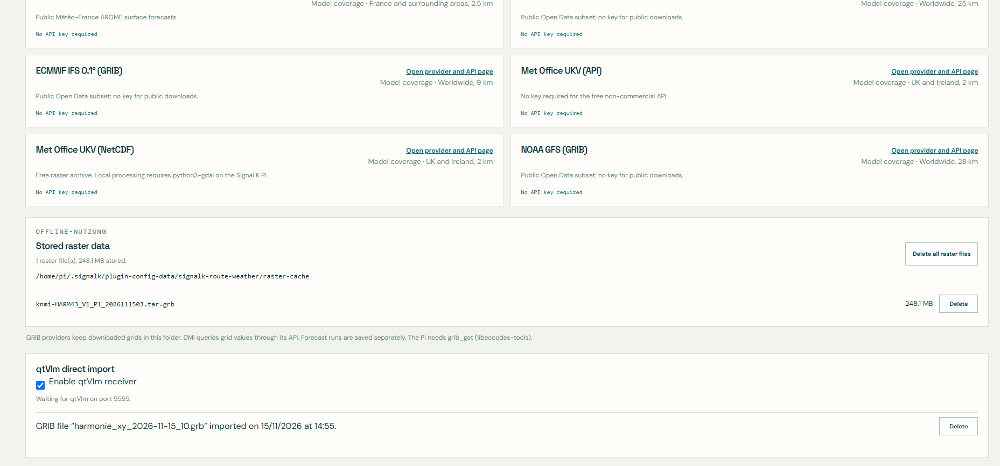

# LTC_Ocpn_Route_Importer v.1.1.47

**See what weather to expect when you reach each waypoint.** This Signal K app calculates your arrival time along the route and shows the forecast for those times. It can use your boat’s instruments, polar data and tidal current predictions to refine the ETA.

## Import a route

| Source | How to use it |
|---|---|
| **OpenCPN** | For direct transfer, install the external **Signal K Route Sender** plugin in OpenCPN. It uses your configured Signal K connection and can send one or several routes. [Download the OpenCPN plugin from GitHub](https://github.com/SignalKuser/LTC_Ocpn_Route_Importer/releases/tag/v.1.1.44) |
| **qtVlm** | Enable the qtVlm receiver on page 2 and send routes or GRIB files through **Data Exchanger**. Imported routes appear under **Signal K**. |
| **Signal K** | Choose a route already stored on the server. |
| **GPX** | Use **GPX (Win)** to select files on Windows or **GPX (Pi)** to open files from a folder on the Signal K Pi. If a file contains several routes or tracks, choose the one you want. |

## Weather along the route

Choose a weather provider or select **Own GRIB file**. The table shows the forecast at each waypoint’s estimated arrival time, including wind, temperature and air pressure. Select **Additional forecast data** to request fields offered by the chosen provider. **Additional table columns** controls which of those fields appear in the table.

Supported sources include **Open-Meteo, MET Norway, SMHI, DWD ICON, KNMI and FMI HARMONIE, DMI HARMONIE DINI, KMI ALARO, Météo-France AROME, ECMWF IFS, Met Office UKV and NOAA GFS**. The provider menu shows coverage and grid spacing where available. With Open-Meteo selected, you can also request marine forecast data.

**Saved weather runs** can be reopened offline. You can also evaluate a GRIB file already stored on the Pi without downloading a new forecast.

## How the ETA is calculated

- **Onboard data** can contribute GPS position, speed over ground, speed through water and measured wind. A planned speed is available for planning.
- **Polar data** estimates boat speed from wind strength and the angle to the course. The app supports LTC JSON polars and `twa/tws` CSV polars.
- **Onboard wind reach** controls how far measured wind influences the ETA. Its weight tapers with distance and elapsed time, and the table shows the share of onboard and forecast wind at each waypoint.
- **Tidal currents** can be calculated from local `HARMONIC` and `.IDX` file pairs. With the current option enabled, the app can use a different station or dataset for each waypoint.

The route summary shows total route distance, remaining distance, estimated time to finish and average speed. It also gives the distance and bearing from your GPS position to the next waypoint.

## Install on Signal K

1. Open the **Signal K Appstore** and search for `signalk-route-weather`.
2. Install the package, restart Signal K and enable the plugin.
3. Open **LTC_Ocpn_Route_Importer** under **Webapps**.

For an offline installation, use the `.tgz` package and the PowerShell installer from the GitHub release. GRIB decoding on the Pi requires `libeccodes-tools`. DWD raster downloads also use `bzip2`, and the Met Office UKV NetCDF option requires `python3-gdal`. Page 2 shows the provider setup and any required API keys. [GitHub releases](https://github.com/SignalKuser/LTC_Ocpn_Route_Importer/releases)

The app and its built-in help are available in English, German, Dutch and French.

## More screenshots

### Route sources and ETA settings

### Weather provider selection

### Stored raster data and qtVlm GRIB import

